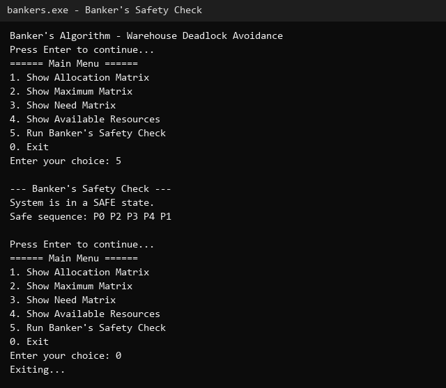
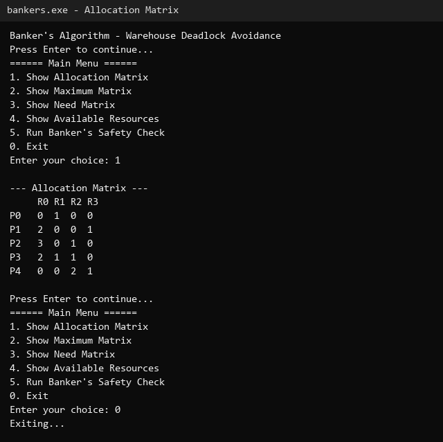
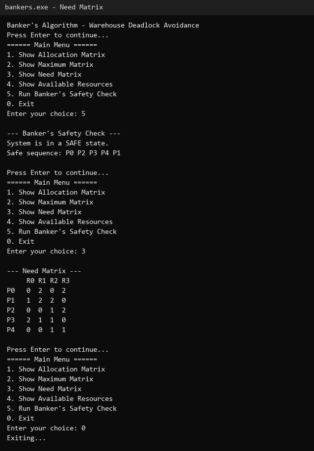
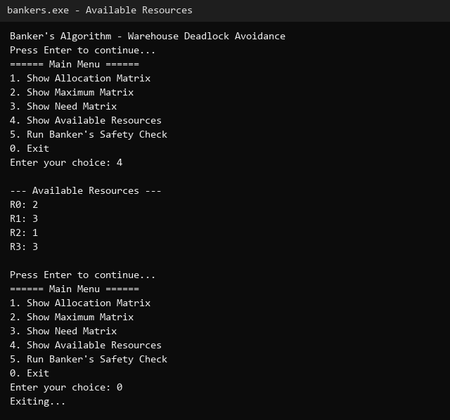

# Operating Systems Assignment 5

## Banker's Algorithm - Warehouse Deadlock Avoidance (case study in C)

**Shaurya Dixit (USN: 1DS25CG046)**  
Subject: Operating Systems

This report documents a working case study of the Banker's Algorithm applied to a warehouse environment, not a bank. The assignment was to apply deadlock avoidance to a real-life application, and I chose a warehouse where forklift operators (processes) compete for shared equipment such as forklifts, pallet jacks, loading docks, and barcode scanners (resources). My program, `bankers.c`, is a single C file that runs in the terminal with a menu-driven interface. It loads a default warehouse scenario, displays the allocation, maximum, need, and available matrices, and runs the Banker's safety algorithm to determine whether all orders can be completed without deadlock.

## How to build and run

```
gcc bankers.c -o bankers
./bankers          (Linux/Mac)
bankers.exe        (Windows)
```

## What is the Banker's Algorithm?

The Banker's Algorithm, designed by Edsger Dijkstra, is a deadlock avoidance algorithm used by operating systems to ensure that resource allocation never leads to deadlock. The name comes from an analogy: a banker must never lend out money in a way that leaves some customers unable to complete their transactions, because that would freeze the whole system. Similarly, an OS must never grant resources to processes in a way that leaves some process stuck forever, waiting for resources that will never become available.

Deadlock happens when every process in a set is waiting for a resource held by another process in the same set, and none can proceed. The Banker's Algorithm prevents this by checking, before granting any resource request, whether the system would still be in a safe state afterward. A safe state means there exists at least one sequence in which all processes can finish: each process gets its remaining needed resources, completes, and releases everything it was holding, which then allows the next process in the sequence to run.

The algorithm works with four data structures for n processes and m resource types:

- Allocation matrix: how many instances of each resource are currently assigned to each process.
- Maximum matrix: the maximum number of each resource that each process may ever request.
- Need matrix: need = maximum - allocation; what each process still needs to finish.
- Available vector: how many instances of each resource are currently free.

## Real-Life Application: Warehouse Order Picking

Imagine a warehouse that processes customer orders. Each order is handled by a forklift operator, and each operator is a process. The equipment they need - forklifts, pallet jacks, loading docks, and barcode scanners - are the resources. Not every operator needs every piece of equipment at once, and not every piece of equipment is available all the time. If two operators each hold one forklift and each needs the other's forklift to finish, neither can move and the warehouse grinds to a halt. That is deadlock.

My program models exactly this situation. There are five order-picking jobs (P0 through P4) and four types of equipment (R0 through R3). The numbers below are a concrete default scenario loaded when the program starts:

- R0: Forklifts
- R1: Pallet jacks
- R2: Loading docks
- R3: Barcode scanners

P0 (urgent electronics order) holds 0 forklifts, 1 pallet jack, 0 loading docks, 0 scanners, and may need up to 0 forklifts, 3 pallet jacks, 0 loading docks, 2 scanners. P4 (bulk pallet wrap) holds 0 forklifts, 0 pallet jacks, 2 loading docks, 1 scanner, and may need up to 0 forklifts, 0 pallet jacks, 3 loading docks, 2 scanners. The warehouse currently has 2 forklifts, 3 pallet jacks, 1 loading dock, and 3 scanners free.

## Design and Code

The whole project is one file, `bankers.c`, using only `stdio.h` and `string.h`. There are no comments in the code so that the logic stands on its own, and every function name describes what it does. The program follows the same menu-driven structure: a main loop reads a number and dispatches to the matching screen.

### Data structures

```c
int n, m;
int alloc[MAX_P][MAX_R], max[MAX_P][MAX_R], need[MAX_P][MAX_R];
int avail[MAX_R], finish[MAX_P], safe[MAX_P];
```

`n` is the number of processes (order-picking jobs) and `m` is the number of resource types (equipment). `alloc` tracks what each job currently holds, `max` tracks what it may ever need, `need` is the difference (what it still needs), `avail` tracks what is free on the floor, `finish` marks which jobs have completed in the safety check, and `safe` records the order in which jobs finish if the system is safe.

### Loading the default warehouse scenario

```c
void loadDefault() {
    n = 5; m = 4;
    int a[5][4] = {{0,1,0,0},{2,0,0,1},{3,0,1,0},{2,1,1,0},{0,0,2,1}};
    int mx[5][4] = {{0,3,0,2},{3,2,2,1},{3,0,2,2},{4,2,2,0},{0,0,3,2}};
    int av[4] = {2,3,1,3};
    ... copy into global tables ...
    calcNeed();
}
```

This function hard-codes a believable warehouse scenario so the demo is ready immediately. It sets 5 jobs and 4 equipment types, fills the allocation and maximum matrices, sets available resources to 2 forklifts, 3 pallet jacks, 1 loading dock, and 3 scanners, marks every job as unfinished, and calls `calcNeed()` to build the need matrix from max - allocation.

### The Banker's safety algorithm

```c
while (count < n) {
    found = 0;
    for (i = 0; i < n; i++) {
        if (finish[i] == 0) {
            for (j = 0; j < m; j++)
                if (need[i][j] > work[j]) break;
            if (j == m) {
                for (k = 0; k < m; k++) work[k] += alloc[i][k];
                safe[count++] = i;
                finish[i] = 1;
                found = 1;
            }
        }
    }
    if (found == 0) break;
}
```

The algorithm keeps a working copy of available resources called `work`. It scans all unfinished jobs. For each job, it checks whether that job's remaining need fits inside `work` - if every needed resource type is available, the job is allowed to run to completion. When it finishes, its allocated resources are returned to `work`. The job is recorded in the safe sequence. If a full scan finds no job that can run, the system is unsafe and the loop stops. If every job finishes, a safe sequence exists and the warehouse will not deadlock.

## Screenshots

Memory Info followed by the Scheduler Demo:



Allocation Matrix:



Need Matrix:



Available Resources:



## Conclusion

The program meets the assignment: a working case study applying the Banker's Algorithm to a real-life application that is not a bank. It demonstrates deadlock avoidance through the allocation, maximum, need, and available matrices, computes the safe sequence, and prints whether the warehouse system is safe. The code stays minimal so that it compiles and runs anywhere, and every screen traces back to a few lines of C.
